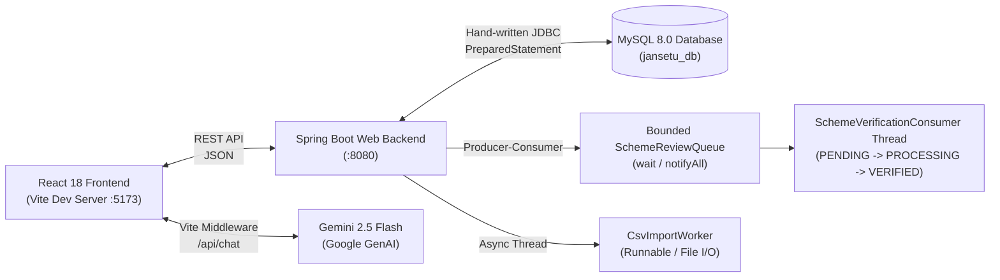

<<<<<<< HEAD
# JanSetu — AI-Powered Government Welfare Scheme Discovery and Management System 🇮🇳

> **Tagline:** AI-Powered Government Welfare Scheme Discovery and Management System

JanSetu is a modern full-stack web platform designed to help citizens discover, evaluate, and track Indian government welfare schemes. The project comprises a high-performance **React 18 + Vite** frontend and a dedicated **Java 17+ Spring Boot** backend powered by **hand-written JDBC** (no JPA, Hibernate, or Spring Data) and **MySQL**. It also serves as a comprehensive **University Java Practical** reference, demonstrating core Java concepts directly in functional application features.

---

## 🏛️ System Architecture



---

## ⚙️ Quick Start & Setup Guide

### 1. Prerequisites
- **Java JDK 17 or higher** (Oracle JDK / OpenJDK)
- **Apache Maven 3.8+**
- **MySQL Server 8.0+**
- **Node.js 18+** & **npm**

---

### 2. Database Setup (MySQL)

1. Open your MySQL client (`mysql -u root -p` or MySQL Workbench).
2. Create the `jansetu_db` database and run the schema script:

```sql
CREATE DATABASE IF NOT EXISTS jansetu_db CHARACTER SET utf8mb4 COLLATE utf8mb4_unicode_ci;
USE jansetu_db;
SOURCE jansetu-backend/src/main/resources/schema.sql;
```

> **Note on Schema Seed**: `schema.sql` automatically creates tables `users`, `schemes`, `saved_schemes`, and `scheme_verifications`, along with indexes and seed records for all 16 central schemes. External portal links (`applicationLink`) directly connect citizens to official government portals.

3. Configure Database Credentials:
Copy `application.properties.example` to `application.properties` (or export environment variables):

```properties
# jansetu-backend/src/main/resources/application.properties
server.port=8080

spring.datasource.url=${DB_URL:jdbc:mysql://localhost:3306/jansetu_db?useSSL=false&serverTimezone=UTC&allowPublicKeyRetrieval=true}
spring.datasource.username=${DB_USER:root}
spring.datasource.password=${DB_PASSWORD:your_mysql_password}
```

*If MySQL is temporarily offline, the backend features automatic graceful fallback to bundled in-memory collections and CSV seeds so development can proceed seamlessly.*

---

### 3. Running the Java Backend

Navigate into `jansetu-backend/` and run via Maven or pre-built JAR:

```bash
# Option A: Maven Spring Boot Plugin
cd jansetu-backend
mvn spring-boot:run

# Option B: Run Pre-built Executable Jar
java -jar target/jansetu-backend-1.0.0.jar
```

The backend starts at `http://localhost:8080`. You will see startup logs confirming the `SchemeVerificationConsumer` background thread is active and listening for verification tasks.

---

### 4. Running the React Frontend

From the root project directory:

```bash
# 1. Install frontend dependencies
npm install

# 2. Configure Gemini API key for Chatbot (Optional but recommended)
# Add your key to .env:
# GEMINI_API_KEY=your_gemini_key_here

# 3. Start development server
npm run dev
```

Open your browser at `http://localhost:5173`. The Vite dev server proxies API calls to `http://localhost:8080` while serving `/api/chat` via local Gemini middleware.

---

## 📚 University Java Practical: Syllabus Concept Mapping

Every required syllabus concept is implemented in real working features with syllabus comments (`// Concept: ...`) above every block:

| # | Java Concept / Topic | Detailed Implementation Description | Primary Class / File | Key Methods / Usage |
|---|----------------------|--------------------------------------|----------------------|---------------------|
| **1** | **Hand-Written JDBC** | Pure JDBC database access without JPA/Hibernate/Spring Data. Uses `DriverManager`/`DataSource`, `Connection`, `PreparedStatement`, `ResultSet`, `executeQuery`, `executeUpdate`, and `try-with-resources`. Never concatenates user input. | `UserRepository.java`<br>`SchemeRepository.java`<br>`SavedSchemeRepository.java`<br>`VerificationRepository.java` | `save()`, `findById()`, `findAll()`, `saveAll()` with parameter indexing `stmt.setString(...)` |
| **2** | **Collections: ArrayList** | Maintains ordered list of all welfare schemes loaded from database; supports indexing and defensive copying. | `SchemeManager.java` | `private final List<Scheme> schemeList = new ArrayList<>();`<br>`getAllSchemes()` |
| **3** | **Collections: HashMap** | O(1) constant-time lookup of schemes by unique ID string. | `SchemeManager.java` | `private final Map<String, Scheme> schemeMap = new HashMap<>();`<br>`getById(String id)` |
| **4** | **Collections: HashSet** | Fast set rejection to prevent duplicate scheme IDs during database loading and CSV batch import. | `SchemeManager.java`<br>`SchemeCsvService.java` | `private final Set<Integer> schemeIdSet = new HashSet<>();`<br>`schemeIdSet.add(s.getId())` |
| **5** | **Collections: LinkedHashSet** | Maintains user's saved/shortlisted schemes in insertion order. | `SavedSchemeRepository.java`<br>`SchemeManager.java` | `Set<Integer> savedIds = new LinkedHashSet<>();` preserves user save sequence. |
| **6** | **Collections: TreeSet** | Maintains alphabetically sorted unique scheme categories. | `SchemeManager.java` | `private final Set<String> sortedCategories = new TreeSet<>();`<br>`getSortedCategories()` |
| **7** | **Collections: TreeMap** | Groups schemes under Indian states in case-insensitive alphabetical key order. | `SchemeManager.java` | `private final Map<String, List<Scheme>> schemesByState = new TreeMap<>(String.CASE_INSENSITIVE_ORDER);` |
| **8** | **Collections: LinkedHashMap (LRU Cache)** | Custom access-order (`accessOrder = true`) cache with maximum capacity 10 for recently viewed schemes; evicts eldest entry automatically via `removeEldestEntry()`. | `SchemeManager.java` | `new LinkedHashMap<Integer, Scheme>(16, 0.75f, true)` overriding `removeEldestEntry()` |
| **9** | **Collections: LinkedList** | Standard FIFO queue for pending scheme verification tasks. | `SchemeManager.java` | `private final LinkedList<VerificationTask> pendingVerificationQueue = new LinkedList<>();` |
| **10** | **Collections: PriorityQueue** | Priority-ordered queue processing urgent verification tasks with highest priority score first. | `SchemeManager.java` | `private final PriorityQueue<VerificationTask> priorityVerificationQueue = new PriorityQueue<>();` |
| **11** | **Collections: Iterator & ListIterator** | Traversal, filtering, and bidirectional iteration across scheme collections. | `SchemeManager.java` | `search(query)` using `Iterator<Scheme>`, `updateSchemeInCollections()` using `ListIterator<Scheme>` |
| **12** | **Streams API** | Functional filtering, transformation, and aggregation pipeline. | `RecommendationService.java` | `schemes.stream().filter(...).sorted(...).distinct().skip(...).limit(...).collect(Collectors.toList())` |
| **13** | **Lambdas & Method References** | Concise functional expressions and method references. | `RecommendationService.java`<br>`Scheme.java` | `Scheme::getState`, `Scheme::getCategory`, `s -> s.getMatch() != null` |
| **14** | **Comparable Interface** | Natural sorting order by scheme name (case-insensitive). | `Scheme.java` | `implements Comparable<Scheme>`<br>`compareTo(Scheme o)` |
| **15** | **Comparator Interface** | Custom ordering comparators for sorting schemes by state, category, and match priority. | `Scheme.java` | `BY_STATE`, `BY_CATEGORY`, `BY_PRIORITY` static Comparators |
| **16** | **Generics: GenericRepository<T, ID>** | Strongly-typed generic CRUD repository interface implemented for User and Scheme entities. | `GenericRepository.java`<br>`UserRepository.java`<br>`SchemeRepository.java` | `public interface GenericRepository<T, ID>` with `save`, `findById`, `findAll`, `update`, `delete` |
| **17** | **Generics: Bounded Type Utility** | Bounded type parameter `<T extends Comparable<T>>` method finding maximum element in collections. | `GenericsUtility.java` | `public static <T extends Comparable<T>> T max(List<T> list)` used in `SchemeService` |
| **18** | **File I/O: BufferedReader / FileReader** | Line-by-line buffered character stream parsing of uploaded scheme CSV files. | `SchemeCsvService.java` | `try (BufferedReader reader = new BufferedReader(new FileReader(file)))` |
| **19** | **File I/O: BufferedWriter / FileWriter** | Buffered character stream writing to export scheme catalog to CSV format. | `SchemeCsvService.java` | `try (BufferedWriter writer = new BufferedWriter(new FileWriter(targetFile)))` |
| **20** | **File I/O: StreamTokenizer** | Token-based parsing alternative extracting numeric values and tokens from CSV streams. | `SchemeCsvService.java` | `StreamTokenizer tokenizer = new StreamTokenizer(reader);` |
| **21** | **File I/O: Binary Streams** | Low-level binary byte-stream file copying creating backup copies of exports. | `SchemeCsvService.java` | `try (FileInputStream fis = ...; FileOutputStream fos = ...)` copying 4KB byte buffers |
| **22** | **Multithreading: Thread & Runnable** | Dedicated background worker executing CSV import pipeline asynchronously without blocking HTTP requests. | `CsvImportWorker.java` | `implements Runnable`<br>`new Thread(this, name).start()` |
| **23** | **Thread Lifecycle & State** | Demonstrates `start()`, `run()`, `sleep()`, `join()`, `interrupt()`, and thread state monitoring. | `CsvImportWorker.java` | `Thread.sleep(600)`, `workerThread.getState()`, `Thread.currentThread().interrupt()` |
| **24** | **Synchronization & Concurrency** | Thread-safe state modifications using synchronized methods/blocks, `volatile` flags, and atomic progress counters. | `CsvImportWorker.java`<br>`SchemeReviewQueue.java`<br>`SchemeManager.java` | `synchronized (schemeManager) { ... }`, `volatile boolean cancelled`, `synchronized` methods |
| **25** | **Producer-Consumer Pattern** | Classic concurrency pattern with a hand-written bounded queue using guarded `wait()` and `notifyAll()` loops. | `SchemeReviewQueue.java`<br>`SchemeVerificationConsumer.java`<br>`SchemeVerificationService.java` | Producer: `SchemeReviewQueue.produce(task)`<br>Consumer: `SchemeVerificationConsumer.run()` with `SchemeReviewQueue.consume()` updating MySQL status via JDBC |

---

## 📡 REST API Catalog

### Welfare Schemes (`/api/schemes`)
| Method | Endpoint | Description |
|---|---|---|
| `GET` | `/api/schemes` | Returns all schemes (from `SchemeManager.getAllSchemes()`) |
| `GET` | `/api/schemes/{id}` | Fetches single scheme by numeric ID and records in LRU Cache |
| `POST` | `/api/schemes` | Creates a new scheme via hand-written JDBC |
| `PUT` | `/api/schemes/{id}` | Updates existing scheme via JDBC and refreshes collections |
| `DELETE` | `/api/schemes/{id}` | Deletes scheme from database and collections |
| `GET` | `/api/schemes/search?q={query}` | Searches schemes using `Iterator<Scheme>` |
| `GET` | `/api/schemes/sort?by={name\|state\|category\|priority}` | Sorts schemes using `Comparable` or `Comparator` |
| `GET` | `/api/schemes/filter?state={state}&category={category}` | Filters schemes |
| `GET` | `/api/schemes/categories` | Returns unique sorted categories from `TreeSet` |
| `GET` | `/api/schemes/grouped-by-state` | Returns schemes grouped by state from `TreeMap` |
| `GET` | `/api/schemes/recently-viewed` | Returns up to 10 recently viewed schemes from `LinkedHashMap` LRU |

### Citizen Users & Saved Schemes (`/api/users`)
| Method | Endpoint | Description |
|---|---|---|
| `POST` | `/api/users` | Creates a new user profile via `UserRepository` |
| `GET` | `/api/users/{id}` | Fetches citizen user details |
| `PUT` | `/api/users/{id}` | Updates citizen profile via JDBC `PreparedStatement` |
| `DELETE` | `/api/users/{id}` | Deletes citizen account |
| `GET` | `/api/users/{id}/saved` | Returns shortlisted schemes in insertion order (`LinkedHashSet`) |
| `POST` | `/api/users/{id}/saved/{schemeId}` | Adds scheme to user's saved shortlist |
| `DELETE` | `/api/users/{id}/saved/{schemeId}` | Removes scheme from user's saved shortlist |

### Streams Recommendations (`/api/users/{id}/recommendations`)
| Method | Endpoint | Description |
|---|---|---|
| `GET` | `/api/users/{id}/recommendations?page=0&size=10&sort=name` | Evaluates eligibility via Java 17 Streams API (`filter`, `sorted`, `limit`, `skip`, `collect`). Includes mandatory disclaimer: *"Preliminary suggestions based on your profile. Check the official scheme website for actual eligibility."* |

### Scheme Verification Pipeline (`/api/verifications`)
| Method | Endpoint | Description |
|---|---|---|
| `POST` | `/api/verifications` | **Producer**: Submits a scheme verification task to bounded `SchemeReviewQueue` |
| `GET` | `/api/verifications` | Lists all scheme verifications (`PENDING`, `PROCESSING`, `VERIFIED`) |
| `GET` | `/api/verifications/{id}` | Retrieves single verification task status |

### Administration & Multithreaded Jobs (`/api/admin`)
| Method | Endpoint | Description |
|---|---|---|
| `POST` | `/api/admin/schemes/import` | Synchronous CSV import using `BufferedReader` and JDBC |
| `POST` | `/api/admin/schemes/import-async` | **Multithreading**: Starts CSV import on background `Thread` (`Runnable`); returns `jobId` immediately |
| `GET` | `/api/admin/jobs/{id}` | Polls job status, percentage progress, and `Thread.getState()` |
| `POST` | `/api/admin/jobs/{id}/cancel` | Sends `Thread.interrupt()` to cancel running worker |
| `GET` | `/api/admin/schemes/export` | **File I/O**: Exports schemes using `BufferedWriter` and creates binary backup copy |

---

## 🧪 Testing and Verification

You can verify all endpoints quickly using `curl` or PowerShell:

```bash
# 1. Categories (TreeSet)
curl http://localhost:8080/api/schemes/categories

# 2. Scheme by ID & LRU Cache
curl http://localhost:8080/api/schemes/1
curl http://localhost:8080/api/schemes/recently-viewed

# 3. Recommendations via Java Streams
curl "http://localhost:8080/api/users/1/recommendations?page=0&size=5&sort=name"

# 4. Multithreaded Scheme Verification Pipeline (Producer-Consumer)
curl -X POST http://localhost:8080/api/verifications \
  -H "Content-Type: application/json" \
  -d '{"schemeId":1,"priority":5,"notes":"Urgent scholarship criteria audit"}'

# Check status after consumer thread processes task (PENDING -> PROCESSING -> VERIFIED):
curl http://localhost:8080/api/verifications

# 5. Background Async CSV Import & Thread Monitor
curl -X POST http://localhost:8080/api/admin/schemes/import-async
# Poll job status with returned jobId:
curl http://localhost:8080/api/admin/jobs/<jobId>
```

---

## 🔒 Security and Credentials

- DB credentials are parameterized in `application.properties` using `${DB_URL}`, `${DB_USER}`, `${DB_PASSWORD}` with fallback defaults.
- No hardcoded secrets exist in repository code.
- Hand-written JDBC queries strictly use `PreparedStatement` with indexed parameter replacement (`?`) to ensure SQL injection immunity.

---

## 📄 License
This project is prepared for educational and practical demonstration purposes.
JanSetu © 2026. Making public support easier to access.
=======
# jansetu
>>>>>>> 6a5b3742d6a9d03dfa82e7d1b80e7e173b06ec10
